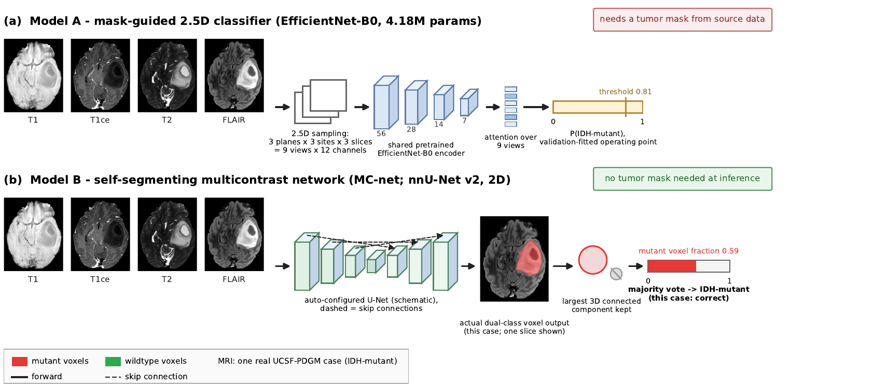

# Predicting Glioma IDH Mutation Status from Multisequence MRI

Can an MRI scan tell whether a diffuse glioma carries an **IDH mutation** - a molecular
marker that normally requires tissue testing? This repo holds the code behind two
working models that predict IDH status from routine preoperative MRI (T1, T1ce, T2, FLAIR):

- **Model A** - a mask-guided 2.5D classifier (EfficientNet-B0, 4.18M params) that needs a
  tumor mask at inference.
- **Model B** - a self-segmenting multicontrast network ("MC-net", nnU-Net v2) that finds
  the tumor itself and needs no mask.



## Class labels

- **Patient level:** `1` = IDH-mutant, `0` = IDH-wildtype.
- **Model B voxel level:** class `1` = IDH-mutant tumor voxels, class `2` = IDH-wildtype
  tumor voxels (the patient's IDH label is pushed onto all of its tumor voxels during
  training). At inference the voxel classes are fused, the largest 3D connected component
  is kept as the whole tumor, and a **majority vote over its voxel classes** becomes the
  patient-level call. The mutant voxel fraction doubles as a probability-like score.

## How each model is trained

| Technique | Model A | Model B | Code |
| --- | --- | --- | --- |
| Pretraining | ImageNet-pretrained EfficientNet-B0 (torchvision) | None - trained from scratch | `baseline2p5d/idh_core.py` |
| Fine-tuning | Backbone frozen for 2 warm-up epochs, then unfrozen | n/a | `baseline2p5d/idh_experiments.py` (`run_training`) |
| Architecture config | Manual comparison of 3 configs; winner: 112px input, lr 1e-4, augmentation-only | Fully automatic nnU-Net v2 configuration (no hyperparameter search) | `baseline2p5d/cell_18.py`, `baseline2p5d/PORT_SPEC.md` |
| Optimization | AdamW, cosine LR schedule, weight decay 1e-4, class-weighted BCE, mixed precision, grad accumulation | nnU-Net default (SGD + poly LR), Dice + CE voxel loss | `baseline2p5d/idh_experiments.py`, nnU-Net v2 |
| Model selection | Early stopping ranked on validation AUROC (patience 5) + validation-only threshold search (operating point 0.81) | Fixed epoch budget, best checkpoint by EMA pseudo-dice (epoch 121) | `baseline2p5d/train_baseline.py`, `nnunet/nnUNetTrainer_Xepochs_save5.py` |
| Input representation | 2.5D: 3 planes x 3 sites x 3 slices = 9 views x 12 channels from a mask-centered 112^3 crop, 1.5 mm spacing | Full-volume 2D nnU-Net over all 4 sequences | `baseline2p5d/idh_core.py`, `nnunet/convert_nnunet.py` |

## Code map

```
baseline2p5d/            Model A
  idh_core.py              dataset, 2.5D sampling, MRI25DNet (attention over 9 views)
  idh_experiments.py       training runner: freeze/unfreeze, cosine LR, early stopping
  train_baseline.py        local retrain driver on the fixed fold-0 split
  build_manifest.py        manifest builder for local retraining
  cell_18.py               the winning configuration, as run
  PORT_SPEC.md             spec for the faithful same-split retrain
  results/                 aggregate metrics, training history, runtimes
nnunet/
  convert_nnunet.py        builds nnU-Net Dataset002_IDHMC (dual-class whole-tumor labels)
  nnUNetTrainer_Xepochs_save5.py  trainer variant: bounded epochs, checkpoint every 5
mcnet_eval/              Model B evaluation
  dcf_eval.py              dual-class fusion + majority-vote patient call
  dcf_eval_pool.py         pooled evaluation driver
  run_test_eval.sh         held-out test evaluation entry point
  dcf_*.json               aggregate results (dev / test / external pools)
error_analysis_20261101/
  error_audit.py           per-case error audit + Dice vs reference masks
  mcnet_timing.py          inference-cost measurement (batch and single-case)
  baseline_test60.py       Model A held-out test evaluation
  overlays.py              error overlay rendering
  *.json                   aggregate audit + timing results
notebooks/
  IDH_Clean_Restart_350_Colab.ipynb  the original Model A pipeline, self-contained (Colab)
figures/                   paper figures (fig_arch via make_arch.py)
```

## Outputs and how to read them

- **Model A** outputs a probability `P(IDH-mutant)`; the validation-fitted operating point
  is **0.81**. Aggregate metrics live in `baseline2p5d/results/`.
- **Model B** outputs a dual-class voxel map plus the patient call (majority vote) and the
  mutant voxel fraction. Aggregate metrics live in `mcnet_eval/`; segmentation quality
  (Dice against reference masks) and inference timing in `error_analysis_20261101/`.
- No patient-level rows, raw scans, or model weights are published here - only code,
  reproduction schemas and aggregate outputs.

## Results (internal evaluation, UCSF-PDGM cohort)

| Evaluation | Model A | Model B |
| --- | --- | --- |
| Paired dev, 47 patients (identical split, both models) | 85.1% acc, AUROC 0.901 | 87.2% acc, AUROC 0.896 |
| Held-out test, 60 patients | 85.0% acc, AUROC 0.895 | **90.0% acc, AUROC 0.932** (sens 88.2%, spec 90.7%) |
| Unseen wildtype-only pool, 143 patients | - | 93.7% specificity (134/143) |
| Whole-tumor segmentation (test-60 audit) | - | median Dice 0.942 |
| Inference cost | ~1.0 s/case (dominated by preprocessing; needs a supplied tumor mask) | ~3.2 s single case, ~0.99 s/case in batch (no mask needed) |

Read these with the caveats:

- The paired dev comparison agrees on 44/47 patients (McNemar exact p = 1.0): with only 3
  discordant pairs the test has no power, so this is a **failure to detect a difference**,
  not proof of equivalence.
- The 60-patient test was run under unmatched protocols (Model A from its original Colab
  run with its own validation-fitted threshold; Model B from a fixed checkpoint with no
  retuning), and the split carries historical exposure from earlier untracked experiments.
  It is internal evidence, **not external validation**.
- Model B's practical advantage is removing the mask dependency - not a proven accuracy or
  speed superiority. Model A is faster per case but useless without a tumor mask; Model B
  runs end-to-end on raw sequences.
- The 143-case external pool is wildtype-only, so it measures specificity alone; mutant
  sensitivity on never-seen data remains unmeasured.

## Data

All patients come from the public **UCSF-PDGM** cohort (CC-BY; please attribute in any
reuse): 350 core cases split patient-disjoint into TRAIN-232 (67 mutant / 165 wildtype),
VAL-58 (selection/threshold only) and TEST-60 (held out), plus 143 additional
wildtype-only cases kept locked as a specificity probe. Raw masks carry BraTS-style labels
{1, 2, 4}; Model B binarizes them (any voxel > 0) and relabels the whole tumor by the
patient's IDH status for dual-class supervision. Patient IDs, manifests with per-patient
rows, raw data, preprocessed arrays and trained weights are intentionally excluded from
this repo.

## Findings

1. A small ImageNet transfer model with staged fine-tuning already reaches ~85-90%
   patient-level accuracy on this cohort - cheap to train (about two minutes on an
   RTX 5070 laptop GPU, 0.31 GB VRAM).
2. The self-segmenting variant matches it on the identical split while dropping the mask
   requirement, and stays specific (93.7%) on 143 never-seen wildtype patients.
3. Segmentation quality is not the failure mode: misclassified cases still had good tumor
   overlap (median Dice 0.92 among errors), so errors come from the IDH signal, not from
   finding the tumor.

## Future work

- **External validation with mutants:** curated TCGA-LGG external cohort (public, via IDC)
  to measure mutant sensitivity on never-seen patients; EGD dataset access requested.
- **Declared early stopping** for every future run (monitored metric, patience 25,
  min delta 0.005) - adopted after a fixed-budget run kept training ~126 epochs past its
  best checkpoint.
- Sub-region (BraTS-style) segmentation instead of whole-tumor binarization.
- Matched-protocol re-evaluation of both models on a fully untouched split.

## Companion paper

IEEE-format paper (Deep Learning course project, NMIMS):
*Patient-Level Prediction of Glioma IDH Mutation Status from Multisequence MRI:
A Mask-Guided 2.5D Classifier Versus a Self-Segmenting Multicontrast Network* -
Param Singh Makwana, Shrijesh Yadav, Deven Yewale, Masooda Modak.

Research code, not a medical device. Not for diagnosis.
